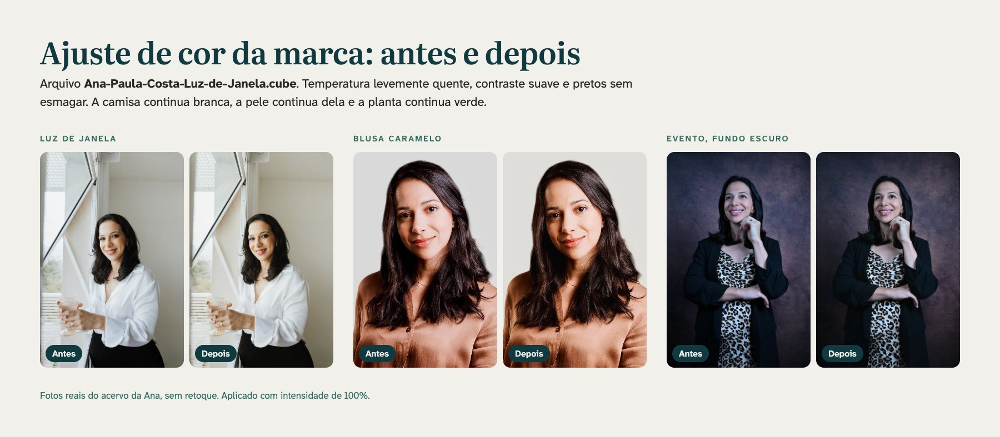

# Pacote de produção · Ana Paula Costa · Nutricionista

Arquivos prontos para quem edita vídeo, cuida das redes ou monta peças da Ana: abertura, encerramento e lower third animados, ajuste de cor, zona segura, legenda e paleta. Tudo segue o manual da marca (seções 14, 16 e 17). O vídeo é da Ana: a marca aparece em três momentos curtos e o resto do tempo é dela.

> **Pendência P1 · CRN-4.** Enquanto o número não chega, as peças trazem "CRN-4 em confirmação". Nada com esse marcador vai a público. Quando o número chegar, rode `python3 tools/kit_video.py --crn "CRN-4 00000"` (com o número real) e todos os vídeos e PNG são refeitos com ele.

## O que tem aqui

| Pasta | Arquivo | Para que serve |
|---|---|---|
| `../video/abertura/` | `abertura-vertical-*.mp4` · `abertura-horizontal-*.mp4` | Cartela de abertura de 2,5 s: o traço escreve o ap., o ponto pousa e o nome entra. Fundos Algodão (pós-parto, padrão), Bruma (gestação) e Mar Fundo (40+) |
| | `abertura-*-claro-alfa.mov` · `abertura-*-escuro-alfa.mov` | A mesma animação sem fundo (canal alfa), para pôr por cima de uma cor ou de um trecho calmo do vídeo. "Claro" é para fundo claro, "escuro" para fundo escuro |
| `../video/encerramento/` | `encerramento-*.mp4` e `-alfa.mov` | Encerramento de 2,5 s: símbolo escrito, ponto, linha do CRN. Fundos Mar Fundo, Sálvia Ana e Algodão |
| `../video/encerramento-curto/` | mesmos nomes | Encerramento de 1 s para Reels e TikTok: o símbolo já está escrito e o ponto pousa aos 0,3 s. É o que o manual pede nos vídeos curtos |
| `../video/lower-third/` | `lower-third-vertical-crn-alfa.mov` · `-fases-alfa.mov` (e os horizontais) + PNG | Cartão com o nome e "Nutricionista", mais uma linha: o CRN ou "Gestação, pós-parto e 40+". Entra em 0,24 s, fica 3,5 s e sai. O PNG é o quadro parado, já na posição certa |
| `cor/` | `Ana-Paula-Costa-Luz-de-Janela.cube` · `previa-antes-depois.jpg` | O ajuste de cor da marca (LUT) e a prévia em três fotos reais |
| `zona-segura/` | `zona-segura-9x16-guia.png` · `-simples` · `-anuncio` · `-capa-reels` · `previa-zona-segura.jpg` | Camadas transparentes de 1080 × 1920 para pôr por cima do vídeo enquanto edita |
| `legenda/` | `exemplo-legenda.srt` · `-sem-cor.srt` · `estilo-legenda.json` · `legenda-referencia.png` · `-medidas.jpg` · `-contorno.jpg` | Modelo de legenda queimada: arquivo de exemplo, especificação e imagem de referência |
| `paleta/` | `ana-paula-costa-paleta.ase` · `.gpl` · `.txt` · `.png` | As cores da marca para Adobe, GIMP, Inkscape, Krita e qualquer editor |

Todos os vídeos têm 30 quadros por segundo, cor Rec.709 e medidas de 1080 × 1920 (vertical) ou 1920 × 1080 (horizontal). Os MP4 são H.264; os MOV são Apple ProRes 4444 com transparência. Cada vídeo tem um PNG `-final.png` com o último quadro, para usar como imagem parada (capa, miniatura, slide).

## Passo a passo no CapCut

- [ ] **Abertura em vídeo longo (YouTube, aula, live):** arraste `abertura-horizontal-algodao.mp4` (ou a versão do modo da série) para o começo da linha do tempo. Em Reels e TikTok, **não** use cartela de abertura: o gancho da Ana vem primeiro.
- [ ] **Lower third:** CapCut não lê a transparência do ProRes em todas as versões. Use o `lower-third-vertical-crn.png` como sobreposição (Sobrepor → Adicionar), do segundo 2 ao 6, com "Esmaecer entrada" de 0,2 s. Ele já está na posição certa: não mexa no tamanho nem na posição.
- [ ] **Legenda:** Texto → Legendas automáticas, depois aplique o estilo da tabela "Legenda queimada" abaixo e salve como predefinição ("Salvar predefinição") com o nome **Ana · legenda**.
- [ ] **Cor:** Ajustar → LUT → Importar → `Ana-Paula-Costa-Luz-de-Janela.cube`. Intensidade entre 60 e 100.
- [ ] **Zona segura:** Sobrepor → `zona-segura-9x16-guia.png` numa faixa acima de tudo. **Apague ou oculte antes de exportar.**
- [ ] **Encerramento:** `encerramento-curto-vertical-mar.mp4` no último segundo, depois que a Ana fez o convite.
- [ ] **Exportar:** 1080p, 30 quadros por segundo, nome `AAAA-MM-DD_rede_quadro_tema.mp4`.

## Passo a passo no Premiere Pro (e no DaVinci Resolve ou Final Cut)

- [ ] Importe os `.mov` de `alfa`: eles já trazem a transparência. Ponha numa faixa acima do vídeo, sem redimensionar.
- [ ] **Legenda:** importe `exemplo-legenda.srt` (Arquivo → Importar) para criar a faixa de legenda, aplique o estilo da tabela abaixo no painel Propriedades e salve como estilo de faixa **Ana · legenda**. O destaque em Sálvia Ana vem marcado no `.srt` com `<font color>`; se o editor ignorar, use o `exemplo-legenda-sem-cor.srt` e pinte a palavra à mão.
- [ ] **Cor:** Lumetri → Básico → LUT de entrada (ou Criativo → Visual) → Procurar → `.cube`. No DaVinci, copie o arquivo para a pasta de LUTs e aplique no último nó. No Final Cut, use o efeito "Personalizar LUT".
- [ ] **Paleta:** no Illustrator, Photoshop ou InDesign, abra o painel Amostras → Abrir biblioteca de amostras → Outra biblioteca → `ana-paula-costa-paleta.ase`.

## Legenda queimada

| Regra | Especificação |
|---|---|
| Fonte | Atkinson Hyperlegible Next SemiBold. Os números saem em Literata (zero aberto) quando o editor deixa misturar fontes |
| Tamanho | 60 px no quadro de 1080 de largura (faixa permitida: 56 a 64 px) |
| Cor do texto | `#F2F0EB` (Algodão) |
| Destaque | Uma palavra por frase em `#63AF9C` (Sálvia Ana), a que carrega o sentido ("jeito", "fase") |
| Caixa | `#103A40` (Mar Fundo) com 85% de opacidade, cantos de 12 px |
| Sem caixa | Texto Algodão com contorno Mar Fundo de 4 px, quando a caixa cobre demais a imagem |
| Posição | Centralizada entre x 60 e 940, base do bloco em y 1500 |
| Limites | 2 linhas, até 32 caracteres por linha. Caixa normal; caixa alta só numa palavra de ênfase |
| Proibido | Emoji na legenda, números de peso ou medida, palavra que prometa resultado |

O arquivo `estilo-legenda.json` traz a mesma especificação em formato de dados, para ferramentas e agentes de edição. O `.srt` de exemplo mostra o ritmo: frases curtas, no máximo duas linhas, convite no fim e o lembrete de falar com quem acompanha a gestante antes de mudar qualquer coisa.

## O ajuste de cor (LUT)

Um único ajuste em todos os vídeos e fotos: temperatura levemente quente, contraste suave e pretos sem esmagar. O aquecimento fica nos tons médios e some no branco e no preto, então a camisa continua branca, a pele continua dela e a planta continua verde. Aplique **depois** de acertar exposição e balanço de branco; a LUT não corrige luz amarela de teto. É proibido filtro de beleza ou efeito que altere a aparência.



## Zona segura (vídeo vertical)

| Camada | Uso |
|---|---|
| `zona-segura-9x16-guia.png` | Completa: faixas cobertas pela rede, área útil, linha dos olhos (y ≈ 640), faixa de título (y 250 a 420), lower third (base em y 1260) e base da legenda (y 1500) |
| `zona-segura-9x16-simples.png` | Só as faixas e o retângulo da área útil, para não poluir enquanto edita |
| `zona-segura-9x16-anuncio.png` | Para anúncio: base de 480 px (linha pontilhada em y 1440) |
| `zona-segura-9x16-capa-reels.png` | Capa de Reels e TikTok: título dentro de x 80 a 1000 e y 420 a 1500, que sobrevive aos cortes 4:5 e 3:4 |

Área útil de todo vídeo vertical: **x de 60 a 940 e y de 250 a 1540**. Rosto, título, legenda e assinatura moram ali.

## Regras que valem para o kit inteiro

- **Um ponto caramelo por peça, e o do logotipo conta.** O encerramento já tem o ponto; o lower third usa a assinatura compacta, que não tem ponto.
- **O símbolo nunca gira, quica, pulsa ou brilha.** Só o traço se desenha e o ponto pousa, na curva "maré" (`cubic-bezier(.33, 0, .15, 1)`).
- **Logotipo sobre foto só em área calma ou sobre faixa sólida** (Sálvia Ana, Mar Fundo ou Algodão). Os MOV de alfa não são para pôr em cima de imagem agitada.
- **Fotos e vídeos só com a Ana sozinha**, sem imagem de pessoa criada por inteligência artificial. Uso comercial das fotos dos ensaios depende da autorização dela (pendência P3).
- **Nada com "em confirmação" vai a público.**

## Paleta

| Cor | Hex | RGB | Uso |
|---|---|---|---|
| Sálvia Ana | `#63AF9C` | 99 175 156 | Cor-assinatura, superfícies grandes |
| Algodão | `#F2F0EB` | 242 240 235 | Fundo claro, leitura, texto da legenda |
| Bruma | `#D8ECE5` | 216 236 229 | Segunda superfície, modo gestação |
| Mar Fundo | `#103A40` | 16 58 64 | Símbolo, títulos, caixa da legenda, modo 40+ |
| Sálvia Funda | `#2F6E60` | 47 110 96 | Texto verde, botões, linha do lower third |
| Pedra | `#E4E0D8` | 228 224 216 | Cartões e fundos de apoio |
| Caramelo | `#C99A68` | 201 154 104 | O ponto (um por peça) |
| Caramelo Tostado | `#8A5A2E` | 138 90 46 | Texto quente e links |
| Ouro Velho | `#C9B583` | 201 181 131 | Acento do modo 40+, só sobre Mar Fundo |
| Grafite Quente | `#2B2724` | 43 39 36 | Texto corrido longo |

CMYK, proporções e as três cores derivadas estão em `paleta/ana-paula-costa-paleta.txt` e na imagem `paleta/ana-paula-costa-paleta.png`.

## Como refazer os arquivos

Tudo é gerado por script a partir da marca oficial, sem edição à mão:

```
python3 tools/sync_marca.py                         # traz a versão mais nova da marca
python3 tools/kit_video.py                          # abertura, encerramentos e lower third
python3 tools/kit_video.py --crn "CRN-4 00000"      # quando o número do CRN chegar
python3 tools/kit_video.py --conferir               # extrai quadros de cada vídeo para conferir
python3 tools/kit_producao.py                       # LUT, zona segura, legenda e paleta
```

Precisa de Python 3.9 ou mais novo com Pillow e Playwright (com o Chromium instalado) e do ffmpeg com os codificadores libx264 e prores_ks.
